<p align="center"></p>

Tell Claude who you're meeting. It researches the company from public information and gets you ready.

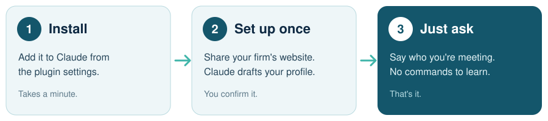

## Install

About five minutes, and you only do it once. Every picture has that step's click circled in yellow.

### Part 1: Add the plugin

**1. Open Settings.** Click your name at the bottom left of Claude, then **Settings**.

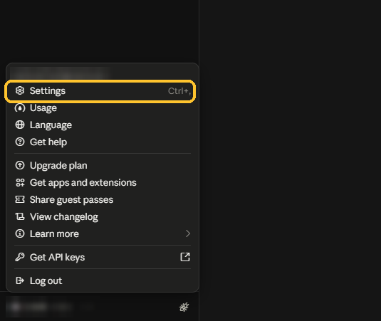

**2. Click Plugins** in the list on the left.

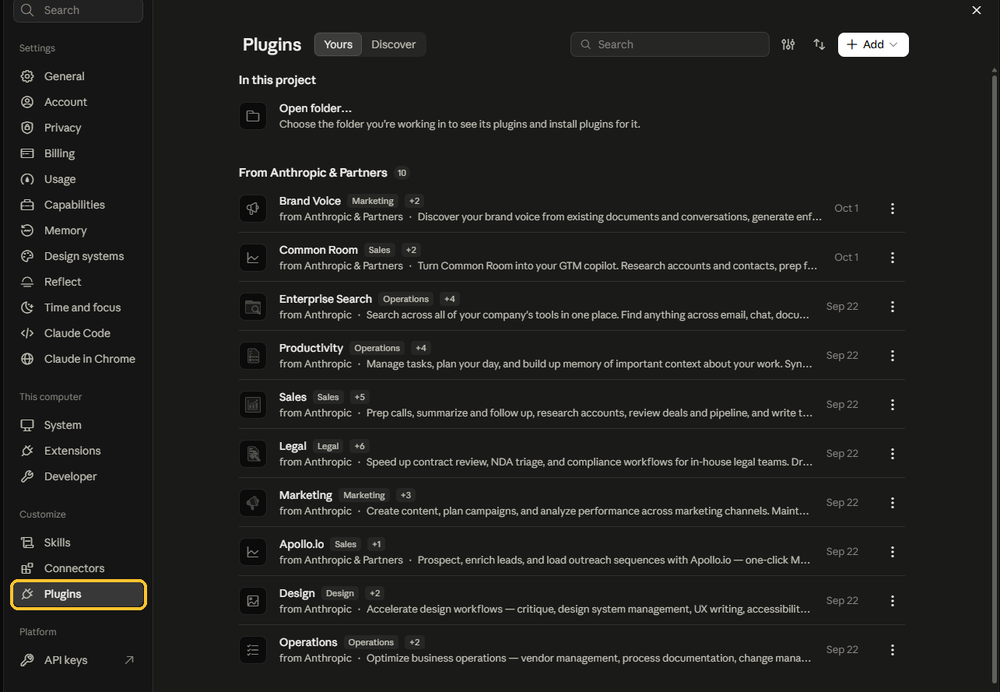

**3. Click Add, then Add marketplace.**

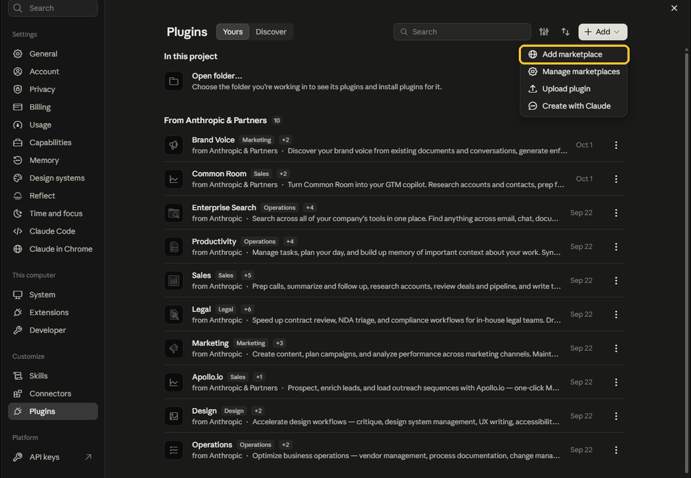

**4. Choose Add from a repository.**

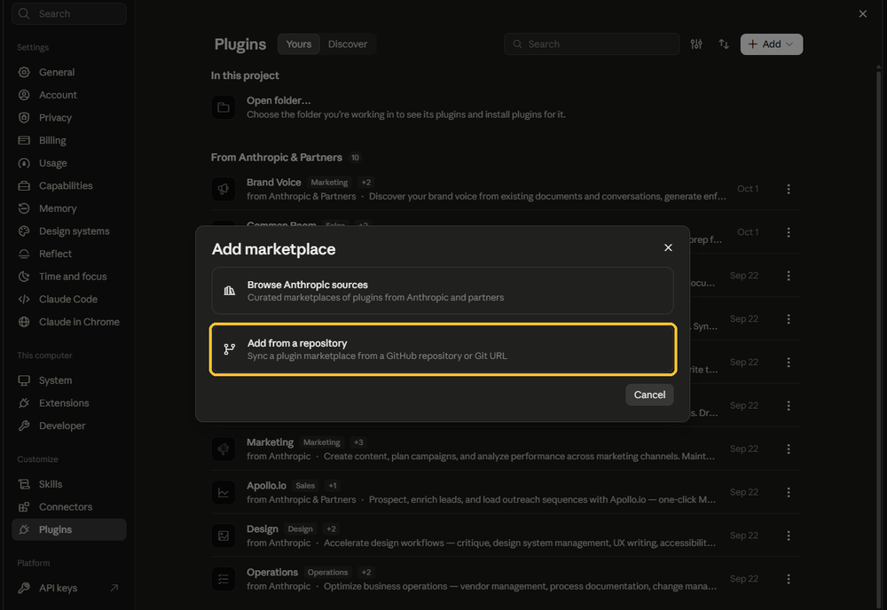

**5. Paste this address and click Sync.**

```
https://github.com/FUNGUScyberpenguin/cyber-sales-recon
```

Claude shows a red warning that marketplace plugins aren't checked by Anthropic. You can read everything it does at that address.

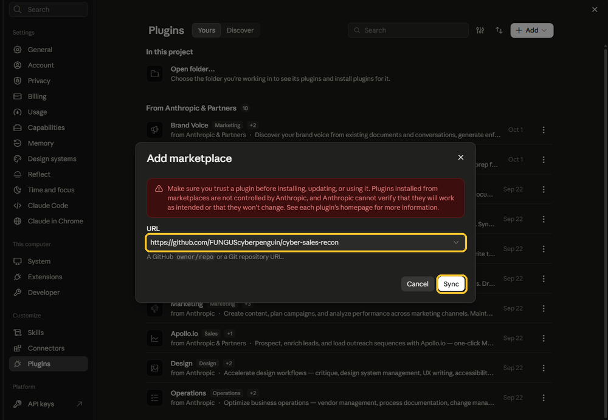

**6. Turn it on.** Scroll to **From marketplaces you added**, open **Opportunity Recon**, and make sure the switch is on.

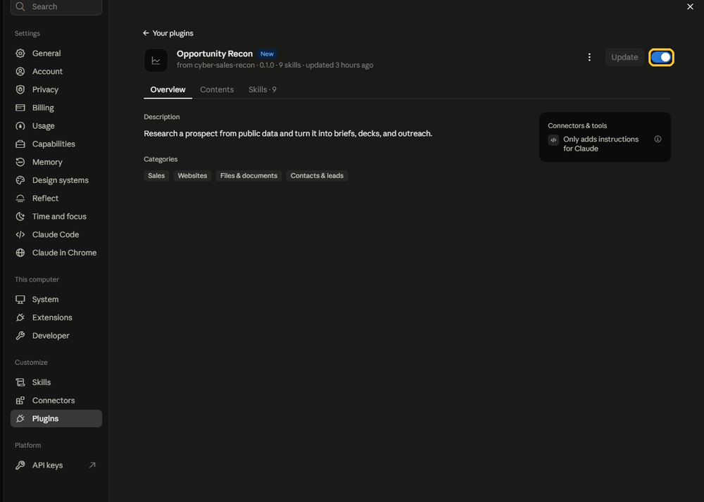

### Part 2: Make a Project

A Project is where Claude keeps your firm profile, so you only set up once.

**7. Click Projects** in the left sidebar.

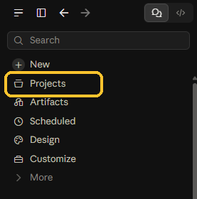

**8. Click New project.**

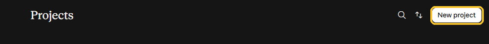

**9. Name it and click Create project.** Any name works. "Sales Tool" is fine.

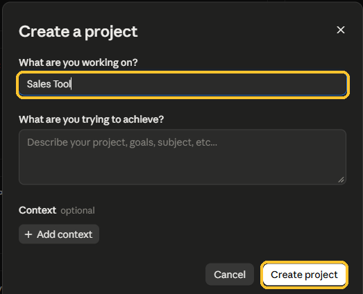

### Part 3: Set it up

**10. Start setup.** Click the box that says "New session" and type: *Set up Opportunity Recon.* Claude asks for your firm's website and a couple of quick questions, then drafts your profile. Fix anything that's off, then say yes.

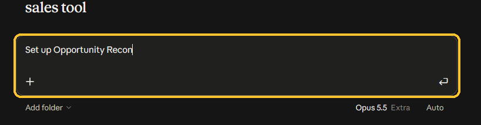

**11. Save the backup.** When setup finishes, Claude prints a block of text. Click **Add** next to **Instructions** on the right and paste it there. If Claude ever forgets your profile, this brings it back.

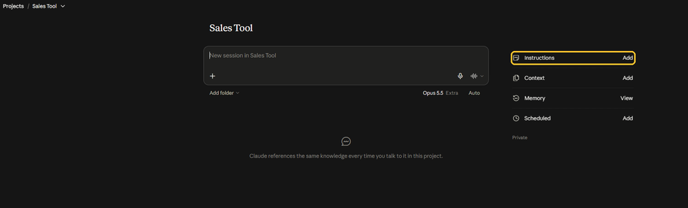

**12. Ask for your first call.** Type who you're meeting, for example: *I'm meeting with acme.com and I need to be ready for the call.*

## Then just ask

Talk the way you would to a coworker. Say who you're meeting.

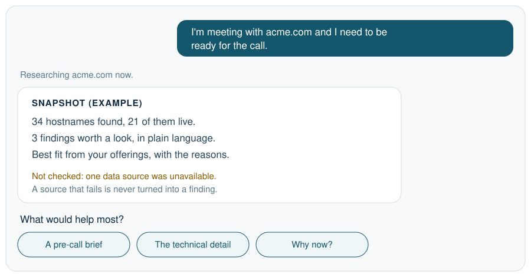

You don't need commands. If you only know the company's name, Claude asks for its website.

## What you can ask for

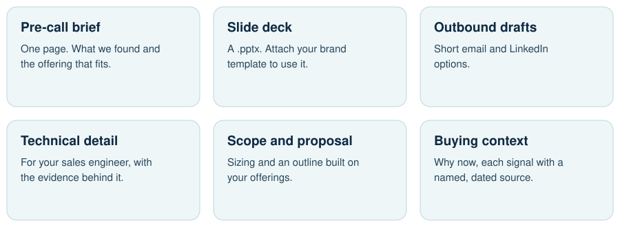

Every claim traces back to something the research found, or to a named, dated source. If your profile is missing a detail, Claude leaves that claim out.

Your profile is kept. Research runs aren't: each one lives in the chat where you made it. In a new chat, ask again.

<details>
<summary><strong>If Claude says research is blocked</strong></summary>

<br>

Your network or workspace is stopping Claude from reaching the public sources. Ask Claude: "Write a note for my IT team about what to allow." It knows what was blocked and, where it can tell, where it's running, so the note names the right hosts and the right setting. Send that note to IT.

</details>

MIT license.
